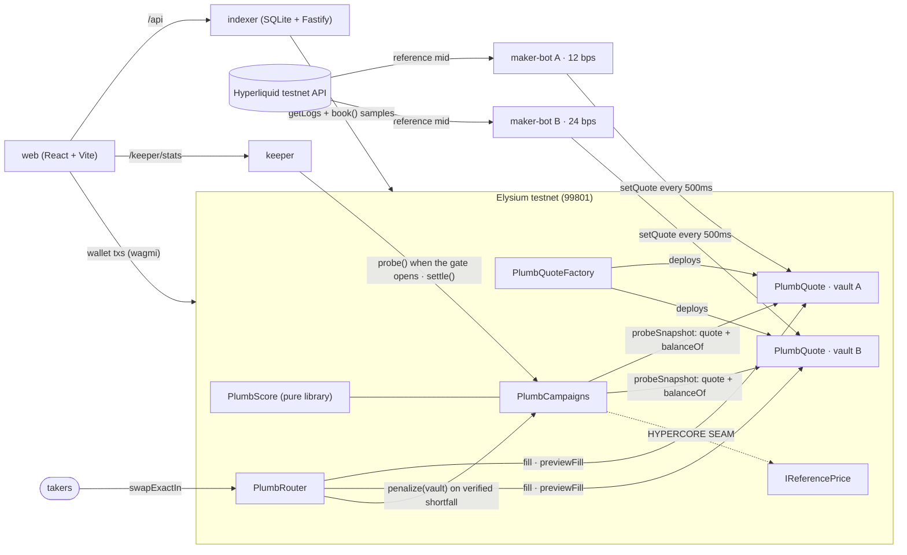

**Live site: [plumbline-elysium.vercel.app](https://plumbline-elysium.vercel.app)** · a static site whose
browser reads the chain itself; wallet actions send real testnet transactions ·
[how it works](https://plumbline-elysium.vercel.app/how-it-works) ·
[try it](https://plumbline-elysium.vercel.app/try) · [faucet](https://plumbline-elysium.vercel.app/faucet) ·
[status](https://plumbline-elysium.vercel.app/status)

> **What this is, plainly.** A testnet demo on Elysium (chain 99801). Nothing here has monetary value.
> * **Live (read from the chain by your browser):** campaigns, vaults and their quotes, and every probe,
>   score, slash, settlement and bond since the first deployment, worked out from the contracts' events.
> * **Snapshot (taken 2026-10-20, labelled as such on the pages):** gas and cost figures, the HYPE price,
>   per-hour quote-update rates and fills from before the snapshot. They need receipts or a price feed
>   that a browser does not read.
> * **PLUMBUSD is a demo asset**: a mintable token with no value, used because testnet USDC cannot be
>   had. The [faucet](https://plumbline-elysium.vercel.app/faucet) hands it out.
> * **No outside market maker has run on Plumbline yet.** Every quote, bond and probe so far came from the
>   project's own wallets and bots. Another wallet has opened a campaign and created a vault on the legacy
>   contract, but no outside maker has quoted, been probed or earned anything.
> * The contracts are unaudited.

<p align="center">
  
</p>

# Plumbline

**Verifiable liquidity uptime on Elysium.**

Token teams pay market makers for "uptime" and "depth" they can't check. Plumbline makes that claim
checkable. Makers quote out of on-chain vaults. Anyone can probe those vaults at unpredictable
moments. A maker earns a point only if, at that instant, its quote was fresh, tight, deep, and **backed
by tokens the vault actually holds**. Rewards are split by points. A quote that looks fillable but isn't
gets its maker's bond slashed the moment a taker hits it.

The design depends on Elysium's 100–200ms blocks and near-zero gas: quotes expire after 2 seconds, so
makers re-post every second or two, and a campaign's probe gate is built to open about every 9 seconds
(a keeper has landed about one probe a minute so far; see *Running the bots*). Neither cadence is
affordable or even physically possible on a one-second chain.

<!-- deployment:start -->
## Deployment (Elysium testnet, chain 99801)

Deployed at block 11477778 (2026-10-19T07:55:09.000Z). Campaigns and router were redeployed as **v2** at block 16395396 (2026-10-26T16:25:18.000Z), against the same factory, to fix the probe gate (see below). **v1 stays on-chain as legacy**: its campaigns, bonds and unclaimed rewards are still there, the app still reads it, new campaigns open on v2. Contracts are verified on the
[Elysium explorer](https://elysium.kinetiq.xyz/testnet-explorer). Freshness window 2s, withdrawal timelock 30s. Demo campaign: **#2**.

| contract | address |
|---|---|
| Verified source, v2 (git tag) | [`deployed-99801-v2-2026-10-26`](https://github.com/ace-coderr/plumbline/tree/deployed-99801-v2-2026-10-26) |
| Verified source, v1 legacy (git tag) | [`deployed-99801-2026-10-19`](https://github.com/ace-coderr/plumbline/tree/deployed-99801-2026-10-19) |
| PlumbQuoteFactory | [`0xaDF8B6b8F39321C81ca52deF1d3605845A5BcEa4`](https://elysium.kinetiq.xyz/testnet-explorer/address/0xaDF8B6b8F39321C81ca52deF1d3605845A5BcEa4) |
| PlumbRouter (v2) | [`0x1A3b2F8fd1afb4C787aEcdd3b45EDC569f3dc673`](https://elysium.kinetiq.xyz/testnet-explorer/address/0x1A3b2F8fd1afb4C787aEcdd3b45EDC569f3dc673) |
| PlumbCampaigns (v2) | [`0xFbC9e2b62132bDdc0C4bC02799D5D5A3e943D786`](https://elysium.kinetiq.xyz/testnet-explorer/address/0xFbC9e2b62132bDdc0C4bC02799D5D5A3e943D786) |
| PlumbRouter (v1, legacy) | [`0x6E1937B16a8B23401133350a84cb6062c03848a6`](https://elysium.kinetiq.xyz/testnet-explorer/address/0x6E1937B16a8B23401133350a84cb6062c03848a6) |
| PlumbCampaigns (v1, legacy) | [`0xdf532CfBA2B047FD3fA3Df1f879617DF17eBAD1c`](https://elysium.kinetiq.xyz/testnet-explorer/address/0xdf532CfBA2B047FD3fA3Df1f879617DF17eBAD1c) |
| PlumbQuote · maker A, WHYPE/PLUMBUSD (12 bps) | [`0x714dAee721B93b3cc6B81eB9a2290a92E331C0e0`](https://elysium.kinetiq.xyz/testnet-explorer/address/0x714dAee721B93b3cc6B81eB9a2290a92E331C0e0) |
| PlumbQuote · maker B, WHYPE/PLUMBUSD (24 bps) | [`0x57Ef55E39Bdd8195580dFFbb522c1DCf23EB78B2`](https://elysium.kinetiq.xyz/testnet-explorer/address/0x57Ef55E39Bdd8195580dFFbb522c1DCf23EB78B2) |
| PlumbQuote · WHYPE/USDC market (registered, unseeded) | [`0x7D59e73a049680F9476c704e7142f9B7EA83F6Dd`](https://elysium.kinetiq.xyz/testnet-explorer/address/0x7D59e73a049680F9476c704e7142f9B7EA83F6Dd) |
| PlumbFaucet (**demo**: hands out PLUMBUSD, 100 per address per day) | [`0x9aA03bd42eaAe9d9f48F12CD42166Fb7B6e40155`](https://elysium.kinetiq.xyz/testnet-explorer/address/0x9aA03bd42eaAe9d9f48F12CD42166Fb7B6e40155) |
| WHYPE (canonical, 18 decimals) | [`0xCD57F65c2B0e5881CFC2E609F7CD53b746E1F234`](https://elysium.kinetiq.xyz/testnet-explorer/address/0xCD57F65c2B0e5881CFC2E609F7CD53b746E1F234) |
| USDC (canonical, 6 decimals) | [`0x7D29d8047B905000459c0E80c34a26CeedcB47b2`](https://elysium.kinetiq.xyz/testnet-explorer/address/0x7D29d8047B905000459c0E80c34a26CeedcB47b2) |
| PLUMBUSD (**demo asset**, mintable, 6 decimals) | [`0x3A3a8e3D34BB815cc211976C17ccf3376C97d750`](https://elysium.kinetiq.xyz/testnet-explorer/address/0x3A3a8e3D34BB815cc211976C17ccf3376C97d750) |

The explorer's verified source is the tagged commit; later commits on `main` may differ from what is
deployed. Generated from
[`packages/shared/src/addresses.ts`](packages/shared/src/addresses.ts), which every package imports.
<!-- deployment:end -->

## Found on Elysium

If a contract of yours uses `block.number` or `blockhash` on Elysium, this applies to you.

**What we expected.** Elysium makes a block about every 140 ms (139 ms measured), and
`eth_blockNumber` counts them. We expected `block.number` inside a contract to be that same number,
and `blockhash(block.number - 1)` to change every block. Plumbline's probe gate was built on it:
each of the last 8 block hashes has a 1-in-64 chance to open the gate, which works out to an
opening about every 9 s.

**What it does.** Elysium is an Arbitrum Orbit chain that settles to HyperEVM. As on any Arbitrum
chain, `block.number` inside the EVM returns the parent chain's block number (HyperEVM's, around
67.39M, while `eth_blockNumber` reports around 12.05M), and `blockhash()` follows it. That number
moves roughly every 12–15 seconds, not once per L2 block. Nothing in the RPC shows this, except the
`l1BlockNumber` field on block objects. `block.prevrandao` is the constant `1` as well.

**What it cost us.** The gate saw new hashes only every 12–15 s, so it opened about 5× less often
than designed: the keeper landed a probe every 1.5–2 minutes instead of every ~22 s (13 s minimum
interval plus the gate wait). The budget planned ~350 probes (347 for campaign #1's two hours); the
two campaigns produced 25. The gate accounts for the 5×; the rest is the keeper's host sleeping
through most of campaign #1.

**The fix.** Read the L2 block number and hash from the ArbSys precompile at `0x64`:
`arbBlockNumber()` and `arbBlockHash(n)`. Both return Elysium's own blocks (we checked
`arbBlockHash` against the RPC's block hashes). The gate now does this in
[`PlumbScore.gateBlockNumber` / `gateBlockHash`](contracts/src/libraries/PlumbScore.sol), falling back to
`block.number`/`blockhash` where nothing answers at `0x64` (anvil, forge tests).
[`PlumbGateArbSys.t.sol`](contracts/test/PlumbGateArbSys.t.sol) runs the gate against a mock ArbSys
while `block.number` stands still.

**Status.** The fix is deployed. `PlumbCampaigns` and `PlumbRouter` (which pins its address) were
redeployed as **v2** against the same factory, so every existing vault carries over; the factory and
vaults bind neither contract. The first pair stays on-chain as **v1 (legacy)** with its campaigns, bonds
and rewards, and the site still reads it. New campaigns open on v2. Verified sources:
[`deployed-99801-v2-2026-10-26`](https://github.com/ace-coderr/plumbline/tree/deployed-99801-v2-2026-10-26)
(v2) and [`deployed-99801-2026-10-19`](https://github.com/ace-coderr/plumbline/tree/deployed-99801-2026-10-19) (v1).
Campaign ids inside the app are `v1 #n` and `v2 #n`, since both contracts count from 1.

**Checked on the live v2 contract.** A throwaway 2-epoch campaign was opened on v2 and `probeGateOpen`
polled for 70 s: it opened 3 times (at 4.4 s, 20.2 s and 54.9 s), where the 1-in-64 odds predict about 8,
so the sample is too short to confirm the 9 s mean, but it shows the gate moving on L2 blocks, not
every 12–15 s. A probe sent right after the gate opened reverted (`GateClosed`): the transaction took
longer to land than the ~1.1 s the gate stays open, so a prober has to send within about a second of an
opening, which a slow RPC round-trip makes hard.

## Demo assets

The seeded market is **WHYPE/PLUMBUSD**. PLUMBUSD ("Plumbline Demo Dollar",
[`contracts/src/test/DemoQuoteToken.sol`](contracts/src/test/DemoQuoteToken.sol)) is a plain 6-decimal
ERC-20 that its owner can mint freely. It exists because canonical USDC is not faucet-available on
Elysium testnet, and this demo was funded with 0.0492 HYPE and nothing else. Every surface that shows a
PLUMBUSD market labels it **demo asset**; it is never rendered as USDC.

* **Faucet.** [`PlumbFaucet`](contracts/src/test/PlumbFaucet.sol) holds PLUMBUSD and sends 100 to any
  address once per 24 hours (`/faucet`). Token, amount and cooldown are immutable and there are no owner
  functions; anyone can add to the pool. The cooldown is per address, so many addresses can claim many
  times: it limits casual repeat claims, not a determined drainer. It also needs a little testnet HYPE for
  gas, which the project does not give out ([the Elysium faucet](https://testnet.elysium.kinetiq.xyz/faucet/) does).

* The canonical **WHYPE/USDC market is deployed and ready**: its pair is registered on-chain by an
  empty vault (see the table above) and canonical USDC stays in `packages/shared`. It is simply unseeded.
* **Nothing in the protocol depends on which quote asset a market uses.** Vaults, the router and
  campaigns read decimals on-chain and treat every ERC-20 the same way. Pointing the seed at USDC
  is a matter of funding, not code.
* Because the demo campaigns pay their pot in PLUMBUSD, makers' bonds are PLUMBUSD too: a campaign's
  bonds are always posted in its reward token. Slashing still works exactly as it would with USDC;
  the live slash below moved PLUMBUSD.

## Business model and mainnet plan

The same text is on the site: [How it works](https://plumbline-elysium.vercel.app/how-it-works).

Plain words, and only what is true today. The plan below describes things that **do not exist yet**; none of it is in the
contracts.

**Today**

* Testnet only (Elysium, chain 99801). No real funds are involved anywhere.
* Every reward, bond and probe fee is paid in PLUMBUSD, a mintable demo token with no value.
* The protocol takes no fee. The contracts have no fee setting, no owner and no admin function that could add one: a campaign's
  pot goes to makers (what is left after probe fees), probe fees go to whoever sent the probe, and slashed bonds go half to the
  reporter and half back into the makers' pot.

**Planned fee, only if and when Plumbline goes to mainnet**

* A small cut, 1 to 3 percent, of **sponsor-funded rewards only**: the pot a sponsor puts in when it opens a campaign.
* **Never a cut of slashes.** If the protocol earned from slashes, it would profit when makers fail, which is the opposite of
  what a service that checks uptime should want.
* A maximum written into the contract so it cannot be raised past it, any change to the fee behind a timelock, and the fee shown
  in the app before a sponsor funds a campaign.
* It starts at 0.
* This needs a new contract version. It would go through the audit below before anything is deployed.

**Mainnet gates (none of these is met yet)**

1. An independent audit of the contracts. There has been none; the tests and the verified source are not an audit.
2. Deposit limits for a capped beta, so early mistakes are small.
3. The HyperCore reference-price read, which is not live yet. Today a campaign either scores spread around each quote's own
   midpoint (reference source set to the zero address) or uses an optional on-chain reference source, whose reading is ignored
   when older than 60 seconds. The maker bot reads Hyperliquid's public price API off-chain for its own quotes. Mainnet scoring
   against a real reference price stays behind that existing optional-source seam.

**Other revenue ideas (ideas, not commitments)**

* Paid reports or attestations for token teams: a signed, dated summary of a market maker's measured uptime, built from the same
  public on-chain data anyone can already read for free. Nothing like this is built or priced.

## How it works

### 1. Quote vaults: `PlumbQuote` + `PlumbQuoteFactory`

A maker deploys a vault for a pair (`createVault(base, quote, quoter)`), funds it with base and quote
inventory, and posts a two-sided quote:

```solidity
setQuote(uint128 bidPx, uint128 askPx, uint128 bidSize, uint128 askSize)
```

* Prices are human-unit quote-per-base scaled by 1e18, so `41.25 USDC per WHYPE` is `41.25e18`
  whatever the token decimals. Sizes are raw base units. Decimals are read on-chain.
* `setQuote` is two storage slots and a timestamp. A quote is **stale after `maxAge` (2s)** and
  can't be filled. That window forces a refresh cadence only Elysium can afford.
* `quoter` is a hot key that can post and cancel quotes but can never move funds.
* Withdrawals are **timelocked** (`requestWithdraw` → wait `withdrawDelay` → `executeWithdraw`). A
  queued amount stops counting as quotable inventory immediately, so inventory can't be moved
  around a probe.
* `fill()` is permissionless. Anyone can take a live quote directly.

### 2. Router: `PlumbRouter`

```solidity
swapExactIn(address base, address quote, bool buyingBase, uint256 amountIn, uint256 minOut, address to)
```

The router ranks every live vault for the pair by price and fills best-first across as many vaults as
needed. When a fill reverts, the router asks the vault for its own diagnosis (`previewFill`).
**Only a verified inventory shortfall is penalized.** A taker therefore can't get an honest maker
slashed by starving the call of gas or by choosing a recipient the token refuses. After a penalized
failure the swap still succeeds with a partial fill and a refund, so the slash is never rolled back.

### 3. Campaigns and probes: `PlumbCampaigns` + `PlumbScore`

A sponsor opens a campaign for a pair, sets the bar (max spread, min ask size, min bid notional,
probe interval, probe fee, maker bond) and funds `rewardPerEpoch × epochs` in HYPE or any ERC20.
Makers bond their vaults in.

`probe(campaignId)` is permissionless. For every bonded vault it reads the quote, the freshness
window and the vault's **actual token balances net of queued withdrawals**, then scores them with the
pure `PlumbScore.evaluate`:

| check | rule |
|---|---|
| fresh | `now - updatedAt < maxAge` |
| tight | `ceil((ask - bid) × 10000 / mid) ≤ maxSpreadBps` |
| deep | `askSize ≥ minDepthBase` and `bidSize × bidPx ≥ minDepthQuote` |
| backed | `freeBase ≥ askSize` and `freeQuote ≥ bid notional` |
| bonded | bond not below `makerBond` after slashes |

Pass = 1 point. Each probe emits a `ProbeResult` per vault with the exact fail mask, so every point
(and every miss) can be audited from the chain. The caller earns `probeFeeBps` of the epoch pot,
capped at 50% of the pot per epoch.

`settle(campaignId)` splits each finished epoch's pot pro-rata by points. All payouts (rewards,
probe fees, released bonds, slash bounties) go to a pull-payment balance and are withdrawn with
`claim(token)`.

**Penalties.** On a verified failed fill the router calls `penalize(vault)`. That slashes 20% of every
bond backing the vault (at most once per probe interval), forfeits the vault's points for the current
epoch, and pays half the slash to the taker and half into the epoch pot for honest makers.
Bonds are released after an unbonding period of one epoch, once every epoch the vault could have
scored in is settled.

### Unpredictable probe timing

Elysium is an Arbitrum Orbit chain, so `block.prevrandao` is the constant `1`. The probe gate takes
its entropy from recent L2 block hashes instead, read from ArbSys (see [Found on Elysium](#found-on-elysium)):

* After `minProbeInterval`, the hashes of the last 8 L2 blocks are checked against a per-campaign seed
  (re-derived from `prevrandao` and the previous block hash at every probe) and the probe nonce. Each
  hash is a hit with probability 1/64; any hit opens the gate and keeps it open for 8 blocks.
* Being memoryless, the wait gives a maker nothing to time a fake quote against: nobody, keepers
  included, knows an opening is coming until the block that creates it.

**Measured on the v1 (legacy) deployment, which predates the ArbSys gate.** On Arbitrum chains the EVM's
`block.number` is the *parent chain's* block number (HyperEVM, about 67.35M), not the L2 block
number (about 11.8M), and `blockhash()` follows it. That number advances in jumps of roughly 15 every
12–15 s rather than every ~150 ms L2 block. The gate therefore reshuffles once per jump, opening
with probability 1 − (63/64)^8 ≈ 11.8% per jump: a mean wait of about 8.5 jumps, roughly 110 s.
The v1 keeper landed one probe every 1.5–2 minutes. Timing was still unpredictable; it was just
about 5× less frequent than designed.

v2 reads the L2 block number and hash from the `ArbSys` precompile (`arbBlockNumber()` /
`arbBlockHash()`) so the gate reshuffles every L2 block: a mean wait of 64 blocks, about 9 s. It changes
`PlumbCampaigns` (and therefore `PlumbRouter`, which pins its address). The v2 source is tag
`deployed-99801-v2-2026-10-26`; v1 is `deployed-99801-2026-10-19`.

### HyperCore seam

`IReferencePrice` (`contracts/src/interfaces/IReferencePrice.sol`) is a clearly marked seam. The
HyperCore market-data precompile isn't live on Elysium yet (it ships in an ArbOS upgrade after
mainnet), so campaigns leave their reference unset and spread is measured around each quote's own
mid. Once an adapter over HyperCore's oracle exists, new campaigns can pass it to `openCampaign`.
`PlumbScore` then measures each quote against the oracle price as
`2 × max(|ref − bid|, |ask − ref|) / ref`, so a quote that is tight but skewed off-market scores as wide.
Stale or reverting references fall back to the mid. Until then the maker bot pulls its reference mid
off-chain from the public Hyperliquid testnet API.

## Architecture



## Repository

```
contracts/            Foundry: PlumbQuote, PlumbQuoteFactory, PlumbRouter, PlumbCampaigns, PlumbScore
  test/               unit + fuzz tests (scoring, slashing, solvency, routing, gate)
  script/Deploy.s.sol
packages/shared/      chain config, generated addresses + ABIs, API types, scoring mirror
packages/keeper/      permissionless prober: gate polling, nonce management, settle, /health /stats
packages/maker-bot/   reference two-sided quoter with inventory skew; cancels when its feed goes stale
packages/indexer/     log indexer (cursor in SQLite), quote sampler, REST API
apps/web/             dashboard + production server (OG tags, rendered report cards)
scripts/              deploy, seed, demo actions, stack runner, ABI generation
```

## Running it

Requirements: Node 20+, pnpm 9, Foundry.

```bash
pnpm install
git submodule update --init --recursive
cp .env.example .env              # fill in testnet keys
pnpm contracts:test               # forge test: unit + fuzz
pnpm abis                         # forge build + regenerate packages/shared/src/abis
```

Deploy, verify and seed:

```bash
pnpm contracts:deploy             # deploys, verifies on the explorer, writes addresses.ts
pnpm build
pnpm budget --write               # size the demo from the measured gas ledger (see Budget)
pnpm seed --verify                # PLUMBUSD, two funded vaults, a PLUMBUSD campaign; writes vaults to .env
```

Run everything (indexer, keeper, two maker bots, web on :8080):

```bash
pnpm stack
```

`pnpm stack --dev` runs from sources with the Vite dev server on :5173. Each service also runs on
its own: `pnpm --filter @plumbline/keeper start` and so on.

### Public site: a snapshot plus a live chain reader

The public site is static: no server, function or database. It ships a snapshot of the indexer's data
(taken at a recorded block) and its browser reads everything that happened on-chain since.

```bash
pnpm export:static                                  # index to the chain head, write the snapshot
pnpm --filter @plumbline/web build:static           # vite build --mode static + report prerender
```

* `pnpm export:static` runs the indexer to the chain head, then writes every response the dashboard
  reads (markets, campaigns, epochs, probes, fills, maker scores, report figures, economics, per-vault
  scorecards) to `apps/web/public/snapshot/` and stamps `meta.json` with the block height and its UTC
  time. It also renders the report link-preview PNGs into `apps/web/public/og/report/`. Both are committed.
* `vite build --mode static` makes the app read those files instead of the REST API (same paths, one
  shared mapping in `packages/shared/src/snapshot.ts`). The default build and `pnpm stack` still use
  the live API: this is a second mode, not a replacement.
* **The live reader** (`packages/shared/src/liveReader.ts`, `apps/web/src/lib/liveStore.ts`) reads, from
  the primary Elysium RPC with the Conduit node as fallback (short timeouts, backoff on rate limits):
  current campaign terms and state on **both campaigns contracts** (v1 legacy and v2), every vault with
  its live quote and balances (contract views, one round of multicalls), and **every event of both
  contracts since the first deploy block** (chunked `getLogs`, five million-block chunks at a time,
  cached in IndexedDB when the browser allows it), plus vault fills and router failed fills after the
  snapshot block. `liveMerge.ts` and `derive.ts` turn that into the shapes the pages use, so a campaign
  created seconds ago appears on `/campaigns`, a new campaign's page loads from the chain, a vault
  created after the snapshot gets a scorecard, and the footer counts vaults quoting right now. First load
  shows the snapshot at once, then takes about 15–20 s on the public nodes to read the whole history; a
  second visit resumes from the cache.
* **The banner says which it is:** "Live from chain, latest block N, updated Xs ago"; the history scan's
  progress while it is still reading; or "RPC unreachable, showing snapshot from <date>" with a retry
  countdown. Until the chain answers, the snapshot is shown and labelled, never an empty list.
* **Worked out in the browser from the events** once the whole history is held
  ([`derive.ts`](packages/shared/src/derive.ts), the indexer's own rules): campaign leaderboards, epochs,
  bonds, slashes and rewards; each market's verified uptime, spread and depth medians and last quotes;
  uptime timelines; a maker's scores and earnings; the depth report and its probe log; probe totals, first
  and last probe times; per-vault pass rates; quote writes (the vaults' own counters); the block time
  (two block timestamps 200,000 blocks apart). `pnpm check:derived` recomputes all of that at the
  snapshot's own block with the browser's code and compares it with the snapshot file: 33 of 33 checks
  match. Until the history has been read (or if a node fails), the pages show the snapshot plus the
  events after it, and the banner says so.
* **Still the snapshot's, labelled "snapshot of <date>" on the pages:** gas per probe and per quote
  update, probe spend and gas price (receipts), the HYPE/USD price, per-hour quote-update rates, and fills
  from before the snapshot block. Fills after it come from the chain.
* Probes in a window: "24h" figures use the chain's own time. With no probe in the last 24 hours they read
  as "none", not as a stale number.
* Rolling windows (24h, 7d) measured back from export time would all hold the same probes, so static
  pages show one window, labelled: the campaign window, from the first campaign's start to the last
  one's end. The live (indexer) build keeps the window toggles.
* The write path is live: opening a campaign, deploying and funding a vault, bonding, settling and
  swapping all send real transactions to the deployed contracts. After one, the page asks the reader to
  look and, for a new campaign, redirects to its page once a node shows it. If no RPC can be reached the
  page says it cannot show the result and links the transaction instead. Defaults on `/campaigns/new` fit
  a testnet-faucet wallet (0.012 HYPE in total), and each action shows its network fee from the measured
  gas table below.
* The reader trusts the RPC node it reads from. A node that returned false logs could mislead it;
  `/verify` compares figures against the chain and is exposed to the same trust. Build with
  `VITE_RPC_URL` set to put your own node first.
* A static host cannot inject per-request meta tags, so the build writes `report/<TOKEN>.html` with
  that report's Open Graph tags; [`vercel.json`](vercel.json) serves it at `/report/<TOKEN>` and falls
  back to the SPA for every other route. Preview images use `PUBLIC_URL` or Vercel's production domain.

To refresh the snapshot after new on-chain activity: rerun `pnpm export:static`, commit, push. Until
then the browser fills the gap itself.

### Running the bots (`pnpm live:bots`)

```bash
pnpm build:bots     # once
pnpm live:bots      # keeper + maker A + maker B under a spend cap
```

One command starts the keeper and both maker bots from `.env`, with prefixed logs on the terminal and in
`logs/live-bots-<UTC date>.log` (git-ignored). It watches the three gas wallets and **stops everything**
when they have spent `LIVE_BOTS_DAILY_HYPE` (default 0.002) since 00:00 UTC, resuming the next UTC day, or when
any of them falls below `LIVE_BOTS_STOP_BELOW_HYPE` (default 0.0002), after which it stays stopped until
someone funds the wallet. Keys stay in `.env`; nothing here puts them anywhere else. The keeper probes every
active campaign on the current (v2) campaigns contract unless `LIVE_BOTS_CAMPAIGNS` names some.

**What it costs, measured on the live chain** (2026-10-26, two bots plus the keeper, public RPC):

| | measured |
|---|---|
| a quote update (`setQuote`) | ~40,000 gas, 0.000004 HYPE |
| two maker bots quoting | 0.000921 HYPE in ~125 s, i.e. **0.0265 HYPE an hour** (paced by the public RPC limit at roughly one update per second each, not the configured 500 ms) |
| keeper probing v2 | about 0.0017 HYPE an hour at the landing rate below, plus settles |
| **1 hour / 4 hours / 12 hours, bots and keeper** | **≈ 0.029 / 0.114 / 0.342 HYPE** |

**Landing probes on v2 is hard.** The v2 gate stays open for about 1.1 s, and a poll or a send takes
about half a second each on the public nodes. The first keeper (one poller) landed 0 of 7 attempts. With
several pollers over both endpoints (`KEEPER_POLLERS`, a quiet period after each attempt) it landed 5 of 14
(36%), about one probe a minute; a failed attempt costs ~56,000 gas, a landed one ~175,000. A longer
gate window would land more, at the price of another redeploy; that is a decision for the owner.

**Unattended, on Cloudflare (built, not deployed, switched off).** [`packages/runner`](packages/runner/README.md) runs the same
keeper and makers as scheduled Durable Objects on a free Workers account, from [`bots.schedule.json`](bots.schedule.json)
(`"enabled": false` as shipped): a daily UTC window, a daily HYPE cap, a floor per wallet, a campaign manager that
opens a PLUMBUSD campaign from a separate sponsor wallet when none is running, a kill switch, and redacted logs. It never uses the
deployer key. The host choice and measurements are in [`hosting-spike/`](hosting-spike/README.md); `/status` shows its schedule and the last
on-chain heartbeat.

### Running the live indexer (Railway)

The [`Dockerfile`](Dockerfile) and [`railway.json`](railway.json) are for when there is ongoing
activity to track. They run one always-on service: the web server with the indexer embedded
(`EMBED_INDEXER=true`), serving the dashboard, the API under `/api`, and link-preview cards from one
process, with SQLite on a persistent volume mounted at `/data`. On an empty volume the indexer
backfills from the deploy block, so the full history rebuilds itself on first boot.

### Indexer API (`:8788`, proxied at `/api` by the web server)

| route | |
|---|---|
| `GET /markets` | every pair: live uptime, best bid/ask, spread, depth, makers |
| `GET /markets/:pair` | ladder (all vaults, with on-chain inventory), recent fills, failed fills |
| `GET /markets/:pair/uptime?window=24h` | bucketed probe coverage + per-probe results; `window=all` spans the market's campaigns |
| `GET /makers/:address` | vaults, bonds, per-epoch scores, earnings |
| `GET /campaigns`, `GET /campaigns/:id` | terms, leaderboard, epoch history, probes, penalties |
| `GET /reports/:token?window=7d` | the public depth report, with per-epoch coverage; `window=all` as above |
| `GET /reports/:token/probes?offset&limit` | full probe log behind a report |
| `GET /vaults/:address/scorecard` | a vault's ProbeResult rows and slashes, for `/scorecard` |
| `GET /economics` | probe and quote gas from receipts, cadence, block time |

Keeper: `GET :8787/health`, `GET :8787/stats`.

## Scorecards and verification

* **`/scorecard/<vault>`** shows what probes verified about one vault: uptime, median spread, verified
  depth, slashes and each epoch: the snapshot's rows plus every probe and slash the chain has recorded
  since (static site), or the live indexer's. A vault no probe has checked shows dashes, not zeros, and a
  vault created after the snapshot says it is still being read until its events are in. Teams can label a
  vault ("Our MM"); the label stays in the browser (localStorage, or memory if storage is blocked) and is
  never sent anywhere or put on-chain. A report downloads as JSON (figures, block, keccak256 hash) or
  prints; the vault's owner can sign the hash with `personal_sign`. A label goes into a file only if you
  tick the box, and is not part of the hash.
* **`/verify`** takes a report and recomputes every figure from the chain with chunked `getLogs`, without
  the indexer, then marks each as MATCH or MISMATCH: the hash, the signature, that the signer owns the
  vault on-chain, the vault's tokens, owner and pair, and each figure. A report with a field it does not
  verify, a repeated epoch, or a block the chain has not reached is refused. If the chain cannot be read
  it says so, shows no result and offers Retry; it never turns a failure into a MATCH. Signatures from
  contract wallets (multisigs) are not supported. A report names a campaigns contract: one that names the
  current (v2) contract covers both v1 and v2; one made before v2 existed names v1 and is checked against
  v1 alone.
* Probe results are public on-chain. Privacy here means a vault address not tied to a team's identity, and
  choosing who receives the report. It does not hide on-chain data. Looking a vault up is a web request:
  this site's host (which serves a file named by the address) and the RPC nodes `/verify` reads from can
  see which address was asked about, as with any web request.
* `pnpm test` runs the scoring, hashing, signing, log-scanning and live-merge tests. `pnpm check:scorecard`
  compares every vault in the snapshot with the chain; `pnpm export:static --scorecards-only` regenerates
  the per-vault files at the snapshot's own block.

## 60-second demo

With `pnpm stack` running and the dashboard open at `http://localhost:8080` (the static site shows
the same pages from the snapshot; step 3 needs the live stack):

1. **0–10s · Markets** (`/`): WHYPE/PLUMBUSD, tagged *demo asset*, with live uptime, a 12 bps
   spread and two makers quoting; WHYPE/USDC sits registered and unseeded. Quote updates count up.
2. **10–20s · Market** (`/market/WHYPE-PLUMBUSD`): the uptime timeline and the probe strip, where
   every tick is a probe transaction (click one). The ladder shows both vaults with on-chain
   inventory checks.
3. **20–35s · Teeth:** run `pnpm demo fake-fill`. A rogue vault undercuts the book with ten times the
   WHYPE it holds. A taker hits it, the router catches the revert, verifies the shortfall and slashes
   20% of the bond, half to the taker and half to honest makers. The market page lists it under
   *Failed fills*; the campaign page shows the penalty.
4. **35–45s · Campaign** (`/campaign/1`): leaderboard with points, uptime, median spread and earnings;
   the 12 bps and 24 bps makers side by side. Every epoch was settled on-chain by the keeper.
5. **45–55s · Report** (`/report/WHYPE`): the shareable certificate. Verified uptime in very large
   type, the campaign terms in plain sentences, inventory-backed depth, coverage per epoch, and every probe
   linked to its transaction. Shared links unfurl with the number on the card.
6. **55–60s · Economics** (`/economics`): why a 2-second quote needs ~140 ms blocks (15 chances to
   re-stamp it, against 2 on a one-second chain), then gas measured from receipts next to the same
   cadence on that chain, in gas units, native tokens and, labelled as price-dependent, dollars.

`pnpm demo swap 0.02` sends an ordinary taker trade through the router.

## Budget

The whole live deployment, seed and demo ran on **0.05 testnet HYPE**, with no top-ups and no USDC.
Elysium charges a flat **0.1 gwei** base fee (receipts show 100,000,001 wei), and the L1 posting
component is about 400 gas per transaction, so 1M gas costs 0.0001 HYPE. Every number below is a
receipt: first rehearsed on a local fork of the live chain (`pnpm seed` + `pnpm measure` +
`pnpm demo fake-fill`, ledger `data/gas-99801-fork.json`), then measured again live
(`data/gas-99801-live.json`, indexer receipts). Fork and live agree to within a few gas
(createVault: 1,697,199 fork, 1,697,212 live).

### Measured gas per action

| action | gas | HYPE at 0.1 gwei | measured |
|---|---:|---:|---|
| deploy PlumbQuoteFactory | 2,647,092 | 0.000265 | live |
| deploy PlumbCampaigns | 3,426,842 | 0.000343 | live |
| deploy PlumbRouter | 1,538,930 | 0.000154 | live |
| deploy DemoQuoteToken (PLUMBUSD) | 627,007 | 0.000063 | live |
| createVault | 1,697,212 | 0.000170 | live |
| openCampaign | 344,457 | 0.000034 | live |
| register + bond | 182,378 | 0.000018 | live |
| **setQuote** (one maker refresh) | **39,948** | **0.000004** | live, sampled receipts |
| **probe**, 2 vaults | **195,128** mean (174k–232k) | **0.000020** | live, every probe |
| settle an epoch | 156,963 | 0.000016 | fork |
| swapExactIn | 180,324 | 0.000018 | live |
| swap that hits an unbacked quote (penalize) | 278,805 | 0.000028 | fork; live run below |
| cancel quote | 30,107 | 0.000003 | live |
| mint / approve / wrap / ERC-20 transfer | 54k / 46k / 58k / 56k | ≤ 0.000006 | live |

### Plan

`pnpm budget` turns the ledger into an allocation. 30% of the balance (0.014772 HYPE) is never
allocated. The rest went to:

| allocation | HYPE | basis |
|---|---:|---|
| seed one-offs | 0.000712 | 7.1M gas: PLUMBUSD, 3 vaults, mints, campaign, bonds |
| maker owner wallets ×2 | 0.000598 | createVault + approve + bond each |
| WHYPE ask inventory | 0.002200 | 0.001 per vault + 0.0002 for the rogue demo (locked, recoverable) |
| rogue fill demo + swap demo | 0.000306 | 3.1M gas |
| maker bots ×2 | 0.024325 | 25 min × 2 refreshes/s × 39,948 gas = 3,000 refreshes each |
| keeper | 0.006107 | 347 probes × 169k gas + 24 settles, for 2 h at a 13 s minimum interval |

**Probe interval arithmetic.** `pnpm budget` searches for the shortest `minProbeInterval` whose
2-hour cost fits the keeper's share: at 13 s plus an assumed 9.7 s mean gate wait, 7,200 s ÷ 22.7 s =
347 probes × 169,286 gas = 58.7M gas, plus 24 settles × 156,963 gas = 3.8M, for 0.0063 HYPE. Live,
the gate reshuffles only when the parent-chain block number jumps (see *Unpredictable probe timing*):
probes landed every ~1.5–2 min, so 2 hours costs about 70 probes × 195k gas + 24 settles ≈
17.4M gas, or 0.0017 HYPE. The keeper was over-provisioned, not under.

**The binding constraint is the makers.** A quote refresh costs the same 39,948 gas at any size, so
two bots at the required 500 ms burn 2 × 2/s × 39,948 gas × 3,600 s ≈ 0.058 HYPE an hour, more than
the entire 0.0492 HYPE. Keeping both makers continuously live for the keeper's two hours would need
about 0.117 HYPE. The plan funded 25 minutes of fast quoting per maker; each bot stops itself
(cancel first) when its wallet reaches its gas floor (`MAKER_*_STOP_BELOW_WEI`).

### Actual spend

| | HYPE |
|---|---:|
| funded | 0.050000 |
| core deploy (3 contracts) | 0.000761 |
| maker bots, both (≈ 6,400 refreshes) | 0.025491 |
| keeper (25 probes, 30 settles, 2 transfers) | 0.000756 |
| deployer (seed, demos, retries) | 0.000588 |
| maker owner wallets | 0.000660 |
| **total gas** | **0.028256** |
| held as WHYPE (recoverable) | 0.002200 |
| left in wallets | 0.019544 |
| deployer balance after everything (30% reserve: 0.014772) | 0.015244 |

What the money bought, all on Elysium testnet: campaign **#1** (24 × 5-minute epochs, 17 probes,
all 24 epochs settled by the keeper) and campaign **#2** (6 × 5-minute epochs, 8 probes, 15 of 16 vault
checks passed, 6 epochs settled), one verified failed fill on a rogue vault
([tx](https://elysium.kinetiq.xyz/testnet-explorer/transaction/0xc3d0bd9f3921ca7558416fd09cfcaff9566571024c8f3e0c01c5402e0f94233f))
that slashed 2 PLUMBUSD of its 10 PLUMBUSD bond, half to the taker and half to honest makers, and
more than 6,000 maker quote refreshes. The run was interrupted once when the host machine slept
through most of campaign #1's window; probes only happen while a keeper is awake.

## Design notes and limits

* **Gas is cheap, not free.** A probe of two vaults costs about 170–230k gas and a quote refresh
  about 40k. At Elysium's 0.1 gwei a maker refreshing every 500 ms burns about 0.029 HYPE an hour,
  which is real money at mainnet HYPE prices and the binding constraint on this demo (see Budget).
* **Public RPC limits.** The public Elysium endpoint rate-limits per IP and rejects bursts. Every
  service paces its requests and retries rate-limited calls (`throttleRpc`), and the maker bots can
  use a separate endpoint (`MAKER_RPC_URL`). Two bots at 500 ms already use most of one IP's allowance.
* **Block-hash entropy is sequencer-visible.** The gate's goal is to make a probe's timing
  unknowable *ahead of time* to makers, not to resist the sequencer itself. A maker that colludes
  with the sequencer is outside the threat model on a testnet. A VRF can replace the gate without
  touching scoring.
* **Bounded loops.** At most 32 listed vaults per pair, 32 bonded vaults per campaign and 16
  campaigns per vault keep routing, probing, settling and slashing within block gas.
* **Reentrancy.** Every value-moving path is `nonReentrant` and follows checks-effects-interactions.
  Rewards use pull payments.
* **No independent market maker has used it.** The vaults, quotes, campaigns and probes shown were run by
  the project's own wallets and bots; the claim that makers can earn from it is untested by anyone
  outside.
* **Testnet only.** Contracts are unaudited. Keys in `.env` are throwaway testnet keys and never
  committed.
