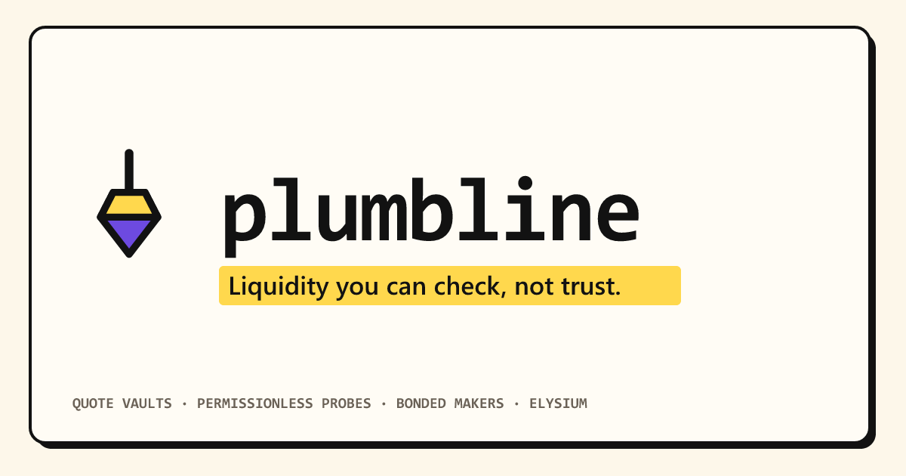

<p align="center">
  
</p>

# Plumbline

**Verifiable liquidity uptime on Elysium.**

Token teams pay market makers for "uptime" and "depth" they can't check. Plumbline makes that claim
checkable. Makers quote out of on-chain vaults. Anyone can probe those vaults at unpredictable
moments. A maker earns a point only if, at that instant, its quote was fresh, tight, deep, and **backed
by tokens the vault actually holds**. Rewards are split by points. A quote that looks fillable but isn't
gets its maker's bond slashed the moment a taker hits it.

The design depends on Elysium's 100–200ms blocks and near-zero gas: quotes expire after 2 seconds, so
makers re-post every block, and probes run every few seconds per campaign. Neither cadence is
affordable or even physically possible on a one-second chain.

<!-- deployment:start -->
## Deployment (Elysium testnet, chain 99801)

Deployed at block 11477778 (2026-10-19T07:55:09.000Z). Contracts are verified on the
[Elysium explorer](https://elysium.kinetiq.xyz/testnet-explorer). Freshness window 2s, withdrawal timelock 30s. Demo campaign: **#2**.

| contract | address |
|---|---|
| PlumbQuoteFactory | [`0xaDF8B6b8F39321C81ca52deF1d3605845A5BcEa4`](https://elysium.kinetiq.xyz/testnet-explorer/address/0xaDF8B6b8F39321C81ca52deF1d3605845A5BcEa4) |
| PlumbRouter | [`0x6E1937B16a8B23401133350a84cb6062c03848a6`](https://elysium.kinetiq.xyz/testnet-explorer/address/0x6E1937B16a8B23401133350a84cb6062c03848a6) |
| PlumbCampaigns | [`0xdf532CfBA2B047FD3fA3Df1f879617DF17eBAD1c`](https://elysium.kinetiq.xyz/testnet-explorer/address/0xdf532CfBA2B047FD3fA3Df1f879617DF17eBAD1c) |
| PlumbQuote · maker A, WHYPE/PLUMBUSD (12 bps) | [`0x714dAee721B93b3cc6B81eB9a2290a92E331C0e0`](https://elysium.kinetiq.xyz/testnet-explorer/address/0x714dAee721B93b3cc6B81eB9a2290a92E331C0e0) |
| PlumbQuote · maker B, WHYPE/PLUMBUSD (24 bps) | [`0x57Ef55E39Bdd8195580dFFbb522c1DCf23EB78B2`](https://elysium.kinetiq.xyz/testnet-explorer/address/0x57Ef55E39Bdd8195580dFFbb522c1DCf23EB78B2) |
| PlumbQuote · WHYPE/USDC market (registered, unseeded) | [`0x7D59e73a049680F9476c704e7142f9B7EA83F6Dd`](https://elysium.kinetiq.xyz/testnet-explorer/address/0x7D59e73a049680F9476c704e7142f9B7EA83F6Dd) |
| WHYPE (canonical, 18 decimals) | [`0xCD57F65c2B0e5881CFC2E609F7CD53b746E1F234`](https://elysium.kinetiq.xyz/testnet-explorer/address/0xCD57F65c2B0e5881CFC2E609F7CD53b746E1F234) |
| USDC (canonical, 6 decimals) | [`0x7D29d8047B905000459c0E80c34a26CeedcB47b2`](https://elysium.kinetiq.xyz/testnet-explorer/address/0x7D29d8047B905000459c0E80c34a26CeedcB47b2) |
| PLUMBUSD (**demo asset**, mintable, 6 decimals) | [`0x3A3a8e3D34BB815cc211976C17ccf3376C97d750`](https://elysium.kinetiq.xyz/testnet-explorer/address/0x3A3a8e3D34BB815cc211976C17ccf3376C97d750) |

Generated from [`packages/shared/src/addresses.ts`](packages/shared/src/addresses.ts), which every package imports.
<!-- deployment:end -->

## Demo assets

The seeded market is **WHYPE/PLUMBUSD**. PLUMBUSD ("Plumbline Demo Dollar",
[`contracts/src/test/DemoQuoteToken.sol`](contracts/src/test/DemoQuoteToken.sol)) is a plain 6-decimal
ERC-20 that its owner can mint freely. It exists because canonical USDC is not faucet-available on
Elysium testnet, and this demo was funded with 0.0492 HYPE and nothing else. Every surface that shows a
PLUMBUSD market labels it **demo asset**; it is never rendered as USDC.

* The canonical **WHYPE/USDC market is deployed and ready**: its pair is registered on-chain by an
  empty vault (see the table above) and canonical USDC stays in `packages/shared`. It is simply unseeded.
* **Nothing in the protocol depends on which quote asset a market uses.** Vaults, the router and
  campaigns read decimals on-chain and treat every ERC-20 the same way. Pointing the seed at USDC
  is a matter of funding, not code.
* Because the demo campaigns pay their pot in PLUMBUSD, makers' bonds are PLUMBUSD too: a campaign's
  bonds are always posted in its reward token. Slashing still works exactly as it would with USDC;
  the live slash below moved PLUMBUSD.

## How it works

### 1. Quote vaults: `PlumbQuote` + `PlumbQuoteFactory`

A maker deploys a vault for a pair (`createVault(base, quote, quoter)`), funds it with base and quote
inventory, and posts a two-sided quote:

```solidity
setQuote(uint128 bidPx, uint128 askPx, uint128 bidSize, uint128 askSize)
```

* Prices are human-unit quote-per-base scaled by 1e18, so `41.25 USDC per WHYPE` is `41.25e18`
  whatever the token decimals. Sizes are raw base units. Decimals are read on-chain.
* `setQuote` is two storage slots and a timestamp. A quote is **stale after `maxAge` (2s)** and
  can't be filled. That window forces a refresh cadence only Elysium can afford.
* `quoter` is a hot key that can post and cancel quotes but can never move funds.
* Withdrawals are **timelocked** (`requestWithdraw` → wait `withdrawDelay` → `executeWithdraw`). A
  queued amount stops counting as quotable inventory immediately, so inventory can't be moved
  around a probe.
* `fill()` is permissionless. Anyone can take a live quote directly.

### 2. Router: `PlumbRouter`

```solidity
swapExactIn(address base, address quote, bool buyingBase, uint256 amountIn, uint256 minOut, address to)
```

The router ranks every live vault for the pair by price and fills best-first across as many vaults as
needed. When a fill reverts, the router asks the vault for its own diagnosis (`previewFill`).
**Only a verified inventory shortfall is penalized.** A taker therefore can't get an honest maker
slashed by starving the call of gas or by choosing a recipient the token refuses. After a penalized
failure the swap still succeeds with a partial fill and a refund, so the slash is never rolled back.

### 3. Campaigns and probes: `PlumbCampaigns` + `PlumbScore`

A sponsor opens a campaign for a pair, sets the bar (max spread, min ask size, min bid notional,
probe interval, probe fee, maker bond) and funds `rewardPerEpoch × epochs` in HYPE or any ERC20.
Makers bond their vaults in.

`probe(campaignId)` is permissionless. For every bonded vault it reads the quote, the freshness
window and the vault's **actual token balances net of queued withdrawals**, then scores them with the
pure `PlumbScore.evaluate`:

| check | rule |
|---|---|
| fresh | `now - updatedAt < maxAge` |
| tight | `ceil((ask - bid) × 10000 / mid) ≤ maxSpreadBps` |
| deep | `askSize ≥ minDepthBase` and `bidSize × bidPx ≥ minDepthQuote` |
| backed | `freeBase ≥ askSize` and `freeQuote ≥ bid notional` |
| bonded | bond not below `makerBond` after slashes |

Pass = 1 point. Each probe emits a `ProbeResult` per vault with the exact fail mask, so every point
(and every miss) can be audited from the chain. The caller earns `probeFeeBps` of the epoch pot,
capped at 50% of the pot per epoch.

`settle(campaignId)` splits each finished epoch's pot pro-rata by points. All payouts (rewards,
probe fees, released bonds, slash bounties) go to a pull-payment balance and are withdrawn with
`claim(token)`.

**Penalties.** On a verified failed fill the router calls `penalize(vault)`. That slashes 20% of every
bond backing the vault (at most once per probe interval), forfeits the vault's points for the current
epoch, and pays half the slash to the taker and half into the epoch pot for honest makers.
Bonds are released after an unbonding period of one epoch, once every epoch the vault could have
scored in is settled.

### Unpredictable probe timing

Elysium is an Arbitrum Orbit chain, so `block.prevrandao` is the constant `1`. The probe gate takes
its entropy from recent block hashes instead:

* After `minProbeInterval`, `blockhash(block.number - k)` for `k = 1..8` is checked against a
  per-campaign seed (re-derived from `prevrandao` and the previous block hash at every probe) and the
  probe nonce. Each hash is a hit with probability 1/64; any hit opens the gate.
* Being memoryless, the wait gives a maker nothing to time a fake quote against: nobody, keepers
  included, knows an opening is coming until the block that creates it.

**Measured on Elysium, and different from the design assumption.** On Arbitrum chains the EVM's
`block.number` is the *parent chain's* block number (HyperEVM, about 67.35M), not the L2 block
number (about 11.8M), and `blockhash()` follows it. That number advances in jumps of roughly 15 every
12–15 s rather than every ~150 ms L2 block. The gate therefore reshuffles once per jump, opening
with probability 1 − (63/64)^8 ≈ 11.8% per jump: a mean wait of about 8.5 jumps, roughly 110 s.
The live keeper landed one probe every 1.5–2 minutes. Timing is still unpredictable; it is just
about 5× less frequent than the 8 s mean the contract comments assume.

The fix is Orbit-native: read the L2 block number and hash from the `ArbSys` precompile
(`arbBlockNumber()` / `arbBlockHash()`) so the gate reshuffles every L2 block. It changes
`PlumbCampaigns` (and therefore `PlumbRouter`, which pins its address), so it ships with the next
deployment. The deployed, verified source is the version in this repository.

### HyperCore seam

`IReferencePrice` (`contracts/src/interfaces/IReferencePrice.sol`) is a clearly marked seam. The
HyperCore market-data precompile isn't live on Elysium yet (it ships in an ArbOS upgrade after
mainnet), so campaigns leave their reference unset and spread is measured around each quote's own
mid. Once an adapter over HyperCore's oracle exists, new campaigns can pass it to `openCampaign`.
`PlumbScore` then measures each quote against the oracle price as
`2 × max(|ref − bid|, |ask − ref|) / ref`, so a quote that is tight but skewed off-market scores as wide.
Stale or reverting references fall back to the mid. Until then the maker bot pulls its reference mid
off-chain from the public Hyperliquid testnet API.

## Architecture


## Repository

```
contracts/            Foundry: PlumbQuote, PlumbQuoteFactory, PlumbRouter, PlumbCampaigns, PlumbScore
  test/               unit + fuzz tests (scoring, slashing, solvency, routing, gate)
  script/Deploy.s.sol
packages/shared/      chain config, generated addresses + ABIs, API types, scoring mirror
packages/keeper/      permissionless prober: gate polling, nonce management, settle, /health /stats
packages/maker-bot/   reference two-sided quoter with inventory skew; cancels when its feed goes stale
packages/indexer/     log indexer (cursor in SQLite), quote sampler, REST API
apps/web/             dashboard + production server (OG tags, rendered report cards)
scripts/              deploy, seed, demo actions, stack runner, ABI generation
```

## Running it

Requirements: Node 20+, pnpm 9, Foundry.

```bash
pnpm install
git submodule update --init --recursive
cp .env.example .env              # fill in testnet keys
pnpm contracts:test               # forge test: unit + fuzz
pnpm abis                         # forge build + regenerate packages/shared/src/abis
```

Deploy, verify and seed:

```bash
pnpm contracts:deploy             # deploys, verifies on the explorer, writes addresses.ts
pnpm build
pnpm budget --write               # size the demo from the measured gas ledger (see Budget)
pnpm seed --verify                # PLUMBUSD, two funded vaults, a PLUMBUSD campaign; writes vaults to .env
```

Run everything (indexer, keeper, two maker bots, web on :8080):

```bash
pnpm stack
```

`pnpm stack --dev` runs from sources with the Vite dev server on :5173. Each service also runs on
its own: `pnpm --filter @plumbline/keeper start` and so on.

### Public site: a static snapshot

Both campaigns are settled and the keeper and bots are off, so the indexed data no longer changes.
The public site is a static export of it, hosted with no server, function or database.

```bash
pnpm export:static                                  # index to the chain head, write the snapshot
pnpm --filter @plumbline/web build:static           # vite build --mode static + report prerender
```

* `pnpm export:static` runs the indexer to the chain head, then writes every response the dashboard
  reads (markets, campaigns, epochs, probes, fills, maker scores, report figures, economics) to
  `apps/web/public/snapshot/` and stamps `meta.json` with the block height and its UTC time. It also
  renders the report link-preview PNGs into `apps/web/public/og/report/`. Both are committed.
* `vite build --mode static` makes the app read those files instead of the REST API (same paths, one
  shared mapping in `packages/shared/src/snapshot.ts`). The default build and `pnpm stack` still use
  the live API: this is a second mode, not a replacement.
* Rolling windows (24h, 7d) measured back from export time would all hold the same probes, so frozen
  pages show one window, labelled: the campaign window, from the first campaign's start to the last
  one's end. The live build keeps the window toggles.
* Every page that shows data carries the snapshot's block height (linked to the explorer) and UTC
  time, and the keeper reads "not running". Every probe, settlement and the slash still links to its
  transaction on the Elysium explorer, so the snapshot can be checked without us.
* A static host cannot inject per-request meta tags, so the build writes `report/<TOKEN>.html` with
  that report's Open Graph tags; [`vercel.json`](vercel.json) serves it at `/report/<TOKEN>` and falls
  back to the SPA for every other route. Preview images use `PUBLIC_URL` or Vercel's production domain.

To refresh the snapshot after new on-chain activity: rerun `pnpm export:static`, commit, push.

### Running the live indexer (Railway)

The [`Dockerfile`](Dockerfile) and [`railway.json`](railway.json) are for when there is ongoing
activity to track. They run one always-on service: the web server with the indexer embedded
(`EMBED_INDEXER=true`), serving the dashboard, the API under `/api`, and link-preview cards from one
process, with SQLite on a persistent volume mounted at `/data`. On an empty volume the indexer
backfills from the deploy block, so the full history rebuilds itself on first boot.

### Indexer API (`:8788`, proxied at `/api` by the web server)

| route | |
|---|---|
| `GET /markets` | every pair: live uptime, best bid/ask, spread, depth, makers |
| `GET /markets/:pair` | ladder (all vaults, with on-chain inventory), recent fills, failed fills |
| `GET /markets/:pair/uptime?window=24h` | bucketed probe coverage + per-probe results; `window=all` spans the market's campaigns |
| `GET /makers/:address` | vaults, bonds, per-epoch scores, earnings |
| `GET /campaigns`, `GET /campaigns/:id` | terms, leaderboard, epoch history, probes, penalties |
| `GET /reports/:token?window=7d` | the public depth report, with per-epoch coverage; `window=all` as above |
| `GET /reports/:token/probes?offset&limit` | full probe log behind a report |
| `GET /economics` | probe and quote gas from receipts, cadence, block time |

Keeper: `GET :8787/health`, `GET :8787/stats`.

## 60-second demo

With `pnpm stack` running and the dashboard open at `http://localhost:8080` (the static site shows
the same pages from the snapshot; step 3 needs the live stack):

1. **0–10s · Markets** (`/`): WHYPE/PLUMBUSD, tagged *demo asset*, with live uptime, a 12 bps
   spread and two makers quoting; WHYPE/USDC sits registered and unseeded. Quote updates count up.
2. **10–20s · Market** (`/market/WHYPE-PLUMBUSD`): the uptime timeline and the probe strip, where
   every tick is a probe transaction (click one). The ladder shows both vaults with on-chain
   inventory checks.
3. **20–35s · Teeth:** run `pnpm demo fake-fill`. A rogue vault undercuts the book with ten times the
   WHYPE it holds. A taker hits it, the router catches the revert, verifies the shortfall and slashes
   20% of the bond, half to the taker and half to honest makers. The market page lists it under
   *Failed fills*; the campaign page shows the penalty.
4. **35–45s · Campaign** (`/campaign/1`): leaderboard with points, uptime, median spread and earnings;
   the 12 bps and 24 bps makers side by side. Every epoch was settled on-chain by the keeper.
5. **45–55s · Report** (`/report/WHYPE`): the shareable certificate. Verified uptime in very large
   type, the campaign terms in plain sentences, inventory-backed depth, coverage per epoch, and every probe
   linked to its transaction. Shared links unfurl with the number on the card.
6. **55–60s · Economics** (`/economics`): probes and quote updates measured from receipts next to the
   same cadence on a one-second chain.

`pnpm demo swap 0.02` sends an ordinary taker trade through the router.

## Budget

The whole live deployment, seed and demo ran on **0.05 testnet HYPE**, with no top-ups and no USDC.
Elysium charges a flat **0.1 gwei** base fee (receipts show 100,000,001 wei), and the L1 posting
component is about 400 gas per transaction, so 1M gas costs 0.0001 HYPE. Every number below is a
receipt: first rehearsed on a local fork of the live chain (`pnpm seed` + `pnpm measure` +
`pnpm demo fake-fill`, ledger `data/gas-99801-fork.json`), then measured again live
(`data/gas-99801-live.json`, indexer receipts). Fork and live agree to within a few gas
(createVault: 1,697,199 fork, 1,697,212 live).

### Measured gas per action

| action | gas | HYPE at 0.1 gwei | measured |
|---|---:|---:|---|
| deploy PlumbQuoteFactory | 2,647,092 | 0.000265 | live |
| deploy PlumbCampaigns | 3,426,842 | 0.000343 | live |
| deploy PlumbRouter | 1,538,930 | 0.000154 | live |
| deploy DemoQuoteToken (PLUMBUSD) | 627,007 | 0.000063 | live |
| createVault | 1,697,212 | 0.000170 | live |
| openCampaign | 344,457 | 0.000034 | live |
| register + bond | 182,378 | 0.000018 | live |
| **setQuote** (one maker refresh) | **39,948** | **0.000004** | live, sampled receipts |
| **probe**, 2 vaults | **195,128** mean (174k–232k) | **0.000020** | live, every probe |
| settle an epoch | 156,963 | 0.000016 | fork |
| swapExactIn | 180,324 | 0.000018 | live |
| swap that hits an unbacked quote (penalize) | 278,805 | 0.000028 | fork; live run below |
| cancel quote | 30,107 | 0.000003 | live |
| mint / approve / wrap / ERC-20 transfer | 54k / 46k / 58k / 56k | ≤ 0.000006 | live |

### Plan

`pnpm budget` turns the ledger into an allocation. 30% of the balance (0.014772 HYPE) is never
allocated. The rest went to:

| allocation | HYPE | basis |
|---|---:|---|
| seed one-offs | 0.000712 | 7.1M gas: PLUMBUSD, 3 vaults, mints, campaign, bonds |
| maker owner wallets ×2 | 0.000598 | createVault + approve + bond each |
| WHYPE ask inventory | 0.002200 | 0.001 per vault + 0.0002 for the rogue demo (locked, recoverable) |
| rogue fill demo + swap demo | 0.000306 | 3.1M gas |
| maker bots ×2 | 0.024325 | 25 min × 2 refreshes/s × 39,948 gas = 3,000 refreshes each |
| keeper | 0.006107 | 347 probes × 169k gas + 24 settles, for 2 h at a 13 s minimum interval |

**Probe interval arithmetic.** `pnpm budget` searches for the shortest `minProbeInterval` whose
2-hour cost fits the keeper's share: at 13 s plus an assumed 9.7 s mean gate wait, 7,200 s ÷ 22.7 s =
347 probes × 169,286 gas = 58.7M gas, plus 24 settles × 156,963 gas = 3.8M, for 0.0063 HYPE. Live,
the gate reshuffles only when the parent-chain block number jumps (see *Unpredictable probe timing*):
probes landed every ~1.5–2 min, so 2 hours costs about 70 probes × 195k gas + 24 settles ≈
17.4M gas, or 0.0017 HYPE. The keeper was over-provisioned, not under.

**The binding constraint is the makers.** A quote refresh costs the same 39,948 gas at any size, so
two bots at the required 500 ms burn 2 × 2/s × 39,948 gas × 3,600 s ≈ 0.058 HYPE an hour, more than
the entire 0.0492 HYPE. Keeping both makers continuously live for the keeper's two hours would need
about 0.117 HYPE. The plan funded 25 minutes of fast quoting per maker; each bot stops itself
(cancel first) when its wallet reaches its gas floor (`MAKER_*_STOP_BELOW_WEI`).

### Actual spend

| | HYPE |
|---|---:|
| funded | 0.050000 |
| core deploy (3 contracts) | 0.000761 |
| maker bots, both (≈ 6,400 refreshes) | 0.025491 |
| keeper (25 probes, 30 settles, 2 transfers) | 0.000756 |
| deployer (seed, demos, retries) | 0.000588 |
| maker owner wallets | 0.000660 |
| **total gas** | **0.028256** |
| held as WHYPE (recoverable) | 0.002200 |
| left in wallets | 0.019544 |
| deployer balance after everything (30% reserve: 0.014772) | 0.015244 |

What the money bought, all on Elysium testnet: campaign **#1** (24 × 5-minute epochs, 17 probes,
all 24 epochs settled by the keeper) and campaign **#2** (6 × 5-minute epochs, 8 probes, 15 of 16 vault
checks passed, 6 epochs settled), one verified failed fill on a rogue vault
([tx](https://elysium.kinetiq.xyz/testnet-explorer/transaction/0xc3d0bd9f3921ca7558416fd09cfcaff9566571024c8f3e0c01c5402e0f94233f))
that slashed 2 PLUMBUSD of its 10 PLUMBUSD bond, half to the taker and half to honest makers, and
more than 6,000 maker quote refreshes. The run was interrupted once when the host machine slept
through most of campaign #1's window; probes only happen while a keeper is awake.

## Design notes and limits

* **Gas is cheap, not free.** A probe of two vaults costs about 170–230k gas and a quote refresh
  about 40k. At Elysium's 0.1 gwei a maker refreshing every 500 ms burns about 0.029 HYPE an hour,
  which is real money at mainnet HYPE prices and the binding constraint on this demo (see Budget).
* **Public RPC limits.** The public Elysium endpoint rate-limits per IP and rejects bursts. Every
  service paces its requests and retries rate-limited calls (`throttleRpc`), and the maker bots can
  use a separate endpoint (`MAKER_RPC_URL`). Two bots at 500 ms already use most of one IP's allowance.
* **Block-hash entropy is sequencer-visible.** The gate's goal is to make a probe's timing
  unknowable *ahead of time* to makers, not to resist the sequencer itself. A maker that colludes
  with the sequencer is outside the threat model on a testnet. A VRF can replace the gate without
  touching scoring.
* **Bounded loops.** At most 32 listed vaults per pair, 32 bonded vaults per campaign and 16
  campaigns per vault keep routing, probing, settling and slashing within block gas.
* **Reentrancy.** Every value-moving path is `nonReentrant` and follows checks-effects-interactions.
  Rewards use pull payments.
* **Testnet only.** Contracts are unaudited. Keys in `.env` are throwaway testnet keys and never
  committed.
